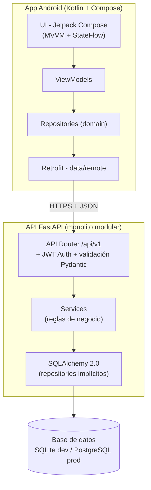
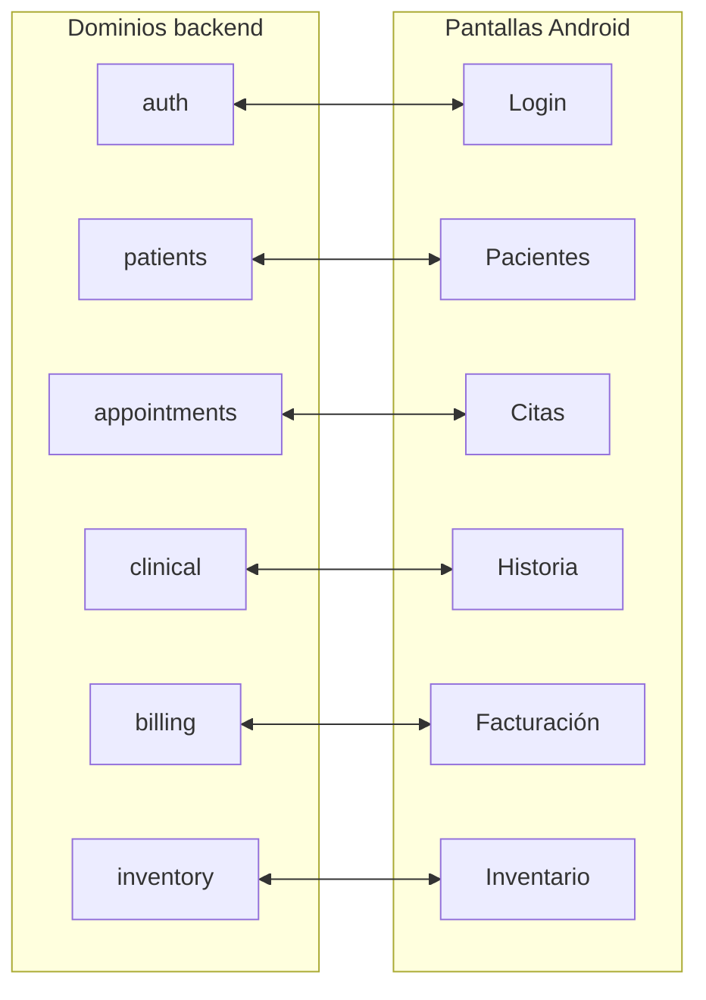
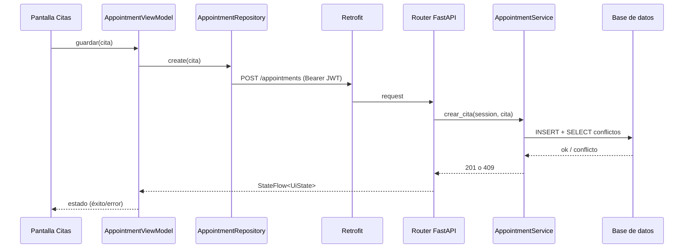

# Arquitectura del Sistema de Clínica

## 1. Requisitos

### Funcionales
- Autenticación con roles (`admin`, `medico`, `recepcion`) y permisos por módulo.
- Gestión de pacientes (ficha, búsqueda, historial).
- Agenda de citas con detección de conflictos de horario.
- Historia clínica por paciente con autor del registro.
- Facturación: conceptos, totales automáticos, pagos y estados.
- Inventario de medicamentos/suministros con movimientos de stock y alertas de mínimo.

### No funcionales
| Categoría | Objetivo |
|-----------|----------|
| Rendimiento | Respuestas < 200 ms p95 en operaciones CRUD |
| Disponibilidad | 99.5% en horario de atención |
| Seguridad | TLS, JWT de corta vida, hash bcrypt, datos médicos cifrados en reposo |
| Escalabilidad | MVP 1 clínica (~50 usuarios concurrentes); escalar a multi-sucursal con réplicas |
| Mantenibilidad | Módulos aislados por dominio, sin acoplamiento cruzado |
| Offline (futuro) | Lectura de fichas/cache local con Room; sincronización diferida |

### Restricciones
- Equipo pequeño, presupuesto bajo → infraestructura simple (monolito + una BD).
- Desarrollo en Android Studio y VS Code.

## 2. Arquitectura de alto nivel



**Estilos combinados:**
- Android: **MVVM + Clean Architecture** en 3 capas (`presentation` → `domain` → `data`).
- Backend: **monolito modular** (hexagonal ligero): `routers` (adaptable) → `services` (caso de uso) → `models` (dominio).

## 3. Estructura de módulos



Cada módulo backend expone su router, su service y sus schemas; cada módulo Android expone su pantalla + ViewModel + repository. Un módulo solo importa de `core/`, `db/` y `domain/` compartidos.

## 4. Capas Android

```
presentation/   Compose UI + ViewModels (StateFlow, Hilt)
domain/         Modelos puros (kotlinx.serialization) + interfaces de repositorio
data/           Implementaciones: Retrofit (remoto), Hilt modules (DI)
core/           Red, sesión, tema, utilidades
```

Reglas:
- `domain` no depende de `data` ni de Android.
- `presentation` solo conoce interfaces de `domain`.
- Solo `data/remote` conoce la URL y el formato JSON del backend.

## 5. Flujo de una petición (ejemplo: crear cita)



## 6. Seguridad

- **Autenticación**: JWT (HS256, expiración 60 min), refresh token simple en Android.
- **Contraseñas**: bcrypt (passlib).
- **Autorización**: dependencia `require_role(...)` en FastAPI; el ViewModel oculta acciones según rol.
- **Validación**: Pydantic en entrada; serialización de salida tipada.
- **Datos sensibles**: sin PII en logs; `EncryptedSharedPreferences` para el token en Android.
- **Cabeceras**: CORS restringido por origen, rate limiting en login (producción).

## 7. Modos de fallo

| Fallo | Impacto | Mitigación |
|-------|---------|------------|
| BD caída | API 500 en todo | Health check `/health`, reintento, avisos en app |
| Token expirado | 401 en app | Interceptor Retrofit → refresh o logout limpio |
| Sin red | Pantallas vacías | Estado `Error` en UiState; cache Room (fase 2) |
| Conflicto de cita | 409 | Validación en service, mensaje claro en UI |
| Stock insuficiente | 409 | Transacción atómica en service de inventario |

## 8. Estrategia de escalado

- **MVP**: 1 proceso uvicorn + SQLite/Postgres, todo en un servidor.
- **10x**: PostgreSQL gestionado, 2+ réplicas detrás de un balanceador, migraciones Alembic, cache Redis para sesiones.
- **Multi-sucursal**: añadir `clinic_id` a las entidades y filtros por tenant.

## 9. Riesgos

| Riesgo | Probabilidad | Mitigación |
|--------|--------------|------------|
| Pérdida de datos clínicos | Media | Backup diario automático + Postgres desde etapa temprana |
| Cumplimiento de privacidad (datos de salud) | Alta | Cifrado en reposo, mínimo privilegio por rol, auditoría de accesos |
| Deriva de API entre app y backend | Media | Contrato en `docs/api.md`, tests de contrato con pytest |
| Acoplamiento entre módulos | Media | Revisar imports en CI; los módulos solo usan `core/`, `db/`, `models/` |
