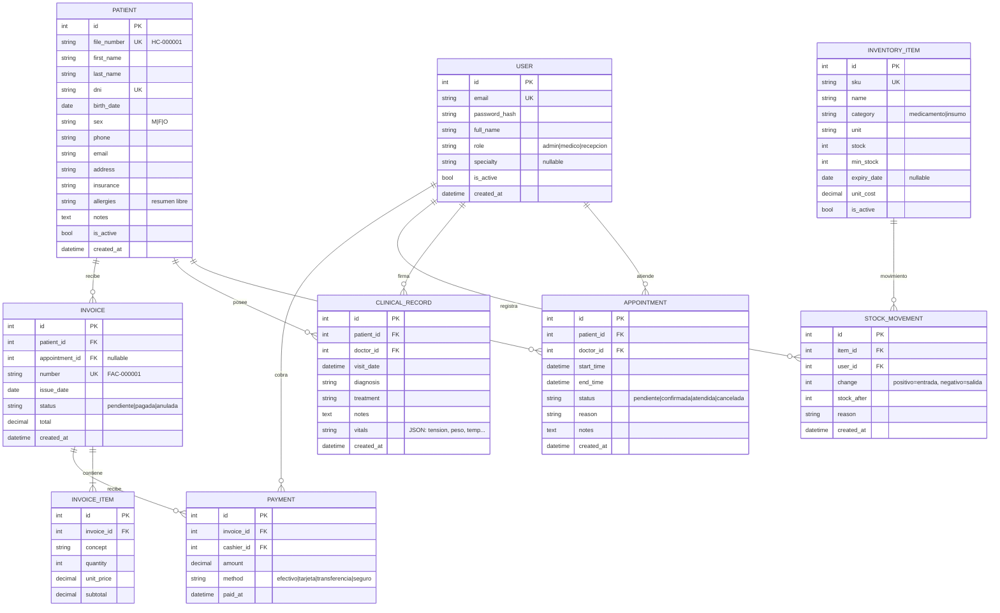

# Modelo de datos

## Diagrama entidad-relación

## Reglas de negocio clave

1. **Nº de historia clínica** (`file_number`) autogenerado: `HC-000001`, único.
2. **Nº de factura** autogenerado: `FAC-000001`, único, inmutable.
3. **Citas**: `end_time > start_time`; sin solape entre citas de mismo médico en estado `pendiente|confirmada`.
4. **Totales de factura**: `total = Σ(quantity × unit_price)`, recalculado en el service, nunca confiado al cliente.
5. **Inventario**: cada modificación de `stock` genera un `STOCK_MOVEMENT` (auditoría); no se permite stock negativo.
6. **Borrado lógico**: `is_active = false` en usuarios, pacientes e ítems; nunca `DELETE` de datos clínicos.
7. **Historia clínica**: solo `medico` crea/edita; `recepcion` solo lee ficha básica; auditoría de quién firmó.

## Estados

- Cita: `pendiente → confirmada → atendida`, con `cancelada` desde cualquier estado previo.
- Factura: `pendiente → pagada` (al cubrirse el total), `anulada` solo si no tiene pagos.
